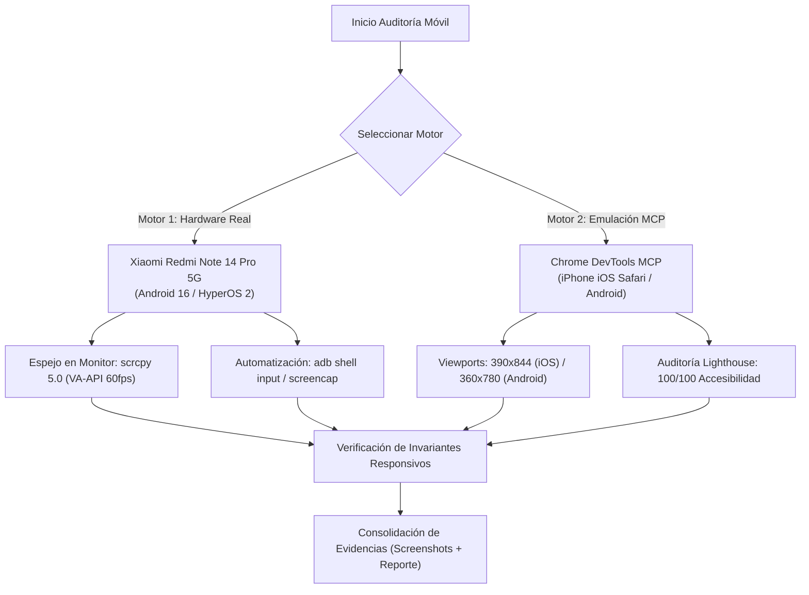
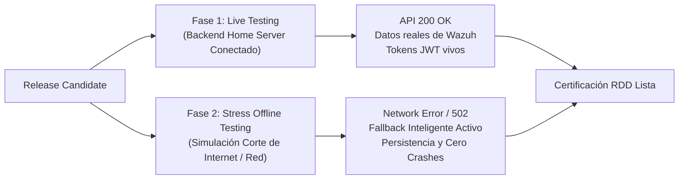

# 📱 Global Mobile QA, UX/UI & Accessibility Testing Standard

Este estándar define el protocolo universal para auditar, probar y certificar la experiencia móvil, el diseño responsivo, la ergonomía de interfaz (UI/UX) y la accesibilidad WCAG (AA y AAA) en todas las aplicaciones web del ecosistema de desarrollo de Johan Posada.

---

## 🏛️ 1. Filosofía y Estrategia de Doble Entorno (Dual-Engine)

El flujo de testing móvil opera bajo dos motores complementarios:



1. **Motor de Hardware Real (Fidelidad 100%):**
   * Valida rendimiento táctil físico, decodificación GPU real, aceleración de red real (WiFi/Datos) y comportamiento nativo de navegadores móviles (Chrome/Brave Mobile sobre Android 16 / HyperOS).
2. **Motor de Emulación MCP (Velocidad, Cobertura Multi-Plataforma y Métricas):**
   * Valida viewports exactos de dispositivos Apple (iPhone 13/14/15 Pro) con User-Agent de iOS Safari y dispositivos Android compactos.
   * Ejecuta auditorías estandarizadas de Lighthouse (Accesibilidad, Buenas Prácticas, SEO) y análisis de nodos del DOM.

---

## 📲 2. Motor 1: Protocolo de Dispositivo Físico (ADB + scrcpy 5.0)

*(Complementa y expande la memoria Engram #258)*

### A. Pre-flight de Conexión USB
1. Conectar el celular vía **cable USB directo** a la estación de trabajo (`sebaslpt`).
2. Verificar reconocimiento en terminal:
   ```bash
   adb devices -l
   ```
   * **Salida esperada:** `NRZ5CQ4DTOJVWCSG device usb:6-1.1 product:malachite_global model:24090RA29G`
   * Si sale `unauthorized`: Confirmar en pantalla del celular *"Permitir depuración USB"*.
   * Si sale vacío: Reiniciar daemon con `adb kill-server && adb devices`.

### B. Espejo de Pantalla en Tiempo Real en la PC (`scrcpy 5.0+`)
> [!IMPORTANT]
> **Compatibilidad con Android 16 / HyperOS 2:**
> La versión de repositorio (`scrcpy 1.25`) arroja errores de `NoSuchMethodException` en `SurfaceControl.createDisplay`. Es mandatorio utilizar **`scrcpy 5.0+`** (vía `/snap/bin/scrcpy` con permisos `raw-usb`).

Lanzar ventana flotante en el escritorio Linux (`DISPLAY=:0`):
```bash
DISPLAY=:0 SNAP_LAUNCHER_NOTICE_ENABLED=false /snap/bin/scrcpy --stay-awake --window-title="Xiaomi Redmi Note 14 Pro 5G - QA"
```
* Ventajas: Permite operar la pantalla táctil con el mouse y teclado de la PC a 60 FPS con aceleración de hardware VA-API (<35ms latencia).

### C. Automatización y Pruebas por Comandos ADB
* **Despertar y desbloquear:** `adb shell input keyevent KEYCODE_WAKEUP`
* **Abrir URL en el navegador del teléfono:**
  ```bash
  adb shell am start -a android.intent.action.VIEW -d "https://tu-app.workers.dev/dashboard"
  ```
* **Simular interacción táctil:**
  * Tap: `adb shell input tap <X> <Y>`
  * Desplazamiento / Swipe: `adb shell input swipe <x1> <y1> <x2> <y2> <duración_ms>`
  * Escribir texto: `adb shell input text "<texto>"`
* **Captura de pantalla limpia (Binary-Safe):**
  ```bash
  adb exec-out screencap -p > /ruta/evidencias/celular_01_vista.png
  ```

---

## 🌐 3. Motor 2: Emulación Multi-Dispositivo (Chrome DevTools MCP)

Utilizar las herramientas de `chrome-devtools-mcp` para simular ecosistemas cruzados:

### A. Perfil iPhone 13 / 14 / 15 Pro (iOS Safari)
```json
{
  "pageId": 1,
  "viewport": "390x844x3,mobile,touch",
  "userAgent": "Mozilla/5.0 (iPhone; CPU iPhone OS 17_4 like Mac OS X) AppleWebKit/605.1.15 (KHTML, like Gecko) Version/17.4 Mobile/15E148 Safari/604.1",
  "colorScheme": "dark"
}
```

### B. Perfil Android Compacto (Pixel / Galaxy / Xiaomi)
```json
{
  "pageId": 1,
  "viewport": "360x780x2.625,mobile,touch",
  "userAgent": "Mozilla/5.0 (Linux; Android 16; 24090RA29G) AppleWebKit/537.36 (KHTML, like Gecko) Chrome/128.0.0.0 Mobile Safari/537.36",
  "colorScheme": "dark"
}
```

---

## 🎯 4. Invariantes de Calidad Móvil (Checklist de Aprobación DoD)

Toda pantalla o flujo móvil debe cumplir estrictamente los siguientes 5 invariantes:

### 1. Invariante de Desbordamiento Cero (Zero Horizontal Overflow)
* **Regla:** En ningún punto del recorrido la pantalla debe tener scroll horizontal global (`window.scrollX === 0` o `document.documentElement.scrollWidth <= window.innerWidth`).
* **Causa común:** Padding fijo duplicado (ej. `p-8` en `MainLayout` + `p-8` en la página), o grids fijos sin `grid-cols-1`.
* **Solución:** Reemplazar `p-8` por `p-3 sm:p-6 md:p-8`, y en tablas anchas usar siempre un contenedor dedicado `w-full overflow-x-auto`.

### 2. Invariante de Cierre de Sesión Inmediato (Instant Logout UX)
* **Regla:** En vistas móviles autenticadas, el botón de **Cerrar Sesión / Salir** debe ser inmediatamente visible y accionable en la barra superior móvil (`sticky top-0`) sin requerir desplazamiento vertical de la página.
* **Ergonomía:** El usuario en móvil no debe buscar el logout al fondo de un dashboard extenso.

### 3. Invariante del Menú Cajón (Accessible Drawer Pattern)
* **Regla:** El menú hamburguesa lateral debe desplegarse sobre la pantalla con un backdrop oscuro (`fixed inset-0 bg-black/70 backdrop-blur-sm`).
* **Comportamiento obligatorio:**
  1. El cajón debe cerrarse automáticamente al hacer clic en el backdrop exterior.
  2. El cajón debe cerrarse automáticamente al hacer tap en cualquier enlace de navegación.
  3. El botón `X` de cierre debe tener `aria-label="Cerrar menú"` y tamaño táctil suficiente.

### 4. Invariante de Tablas y Gráficos Adaptativos
* **Regla:** Tablas de telemetría (Threat Center, Logs, Auditoría) deben tener scroll táctil horizontal suave con bordes redondeados (`rounded-xl border border-hm-border overflow-x-auto`).
* **Filtros:** Los botones de filtros temporales (`24h`, `7d`, `30d`) deben tener contenedor con `overflow-x-auto max-w-full no-scrollbar` para pantallas angostas (360px).

### 5. Invariante de Cumplimiento WCAG (AA y AAA)
* **WCAG 2.5.3 (Label in Name):** Todo botón con texto visible (ej. `"Salir"`) DEBE tener ese mismo texto incluido en su `aria-label` (ej. `aria-label="Salir de la sesión"`). Nunca usar nombres accesibles que contradigan el texto visual (ej. texto `"Salir"` con `aria-label="Cerrar Sesión"` provoca confusión en lectores de pantalla y falla Lighthouse).
* **WCAG 1.4.3 / 1.4.6 (Contraste de Color):** Contraste mínimo de 4.5:1 para texto normal (AA) y 7:1 para AAA.
* **WCAG 2.5.5 / 2.5.8 (Target Size):** Los elementos táctiles interactivos deben tener un área mínima de **44×44 px** o **48×48 px**.
* **Puntaje Objetivo Lighthouse:** **Accessibility: 100 / 100**, **Best Practices: 100 / 100**, **SEO: 100 / 100**.

---

## 📋 5. Playbook de Ejecución Paso a Paso

1. **Paso 1: Levantar Entorno de Testing**
   * Verificar celular con `adb devices -l`.
   * Si se requiere supervisión en vivo: Levantar `scrcpy` en `DISPLAY=:0`.
2. **Paso 2: Emulación y Navegación Básica**
   * Emular iPhone 13 (`390x844`) y Android (`360x780`) vía DevTools MCP.
   * Probar acceso a `/login` y verificar formulario responsive.
3. **Paso 3: Pruebas Funcionales Autenticadas**
   * Iniciar sesión.
   * Verificar barra superior móvil sticky con botón "Salir".
   * Probar apertura y cierre del Drawer lateral.
   * Navegar a `/dashboard`, `/threat-center`, `/logs` y `/settings`.
4. **Paso 4: Auditoría de Accesibilidad**
   * Ejecutar `lighthouse_audit` en modo `snapshot` sobre la sesión móvil.
   * Validar puntaje 100/100 en Accesibilidad y verificar ausencia de violaciones WCAG.
5. **Paso 5: Capturas y Certificación de Calidad**
   * Tomar capturas de pantalla de los hitos y guardarlas en el reporte de entrega.

---

## 🛠️ 6. Playbook Avanzado de Automatización MCP (Chrome DevTools Cheat Sheet)

Para automatizar pruebas E2E robustas mediante `chrome-devtools-mcp` sin fricciones de asincronía ni fallos de permisos:

### A. Inputs Controlados en React (`evaluate_script`)
> [!IMPORTANT]
> En inputs controlados por React (ej. `<input type="date">` o `<input type="text">`), modificar `el.value = '...'` **NO actualiza el estado interno de React**. Se debe utilizar el descriptor del prototipo nativo y despachar los eventos de cambio:
```javascript
() => {
  const input = document.querySelector('#mi-input');
  const nativeSetter = Object.getOwnPropertyDescriptor(window.HTMLInputElement.prototype, 'value').set;
  nativeSetter.call(input, '2026-10-02');
  input.dispatchEvent(new Event('input', { bubbles: true }));
  input.dispatchEvent(new Event('change', { bubbles: true }));
  return { updated: true, value: input.value };
}
```

### B. Interacción con Material-UI SpeedDial y Menús Flotantes
Para hacer clic en acciones anidadas dentro de un SpeedDial (`SpeedDialAction`), localizarlas por su selector de clase o atributo de accesibilidad:
```javascript
() => {
  const actions = document.querySelectorAll('.MuiSpeedDialAction-fab');
  // Localizar por índice o por tooltip/aria-label
  const target = Array.from(actions).find(b => b.getAttribute('aria-label')?.includes('Diccionario'));
  if (target) {
    target.click();
    return { ok: true, clicked: target.getAttribute('aria-label') };
  }
  return { ok: false };
}
```

### C. Capturas de Pantalla Seguras (Workspace Perms Bypass)
El tool `take_screenshot` falla si se pasa un `filePath` absoluto fuera del workspace permitido. La técnica óptima y universal es:
1. Llamar a `take_screenshot` **sin `filePath`** (devolverá el recurso capturado en `.system_generated/steps/.../media_N.png`).
2. Copiar el archivo resultante mediante un comando shell hacia el directorio de artefactos deseado:
   ```bash
   cp /home/sebas/.../.system_generated/.../media_0.png /ruta/artefacto.png
   ```

### D. Verificación de Fidelidad de Reportes PDF (`pdftoppm`)
Cuando la aplicación genera descargas client-side de archivos PDF con `jsPDF`:
1. Verificar la descarga en `~/Downloads/`.
2. Renderizar las páginas a imágenes de alta definición (150 DPI) para auditoría visual en el chat:
   ```bash
   pdftoppm -png -r 150 -f 1 -l 3 ~/Downloads/Reporte.pdf /ruta/artefactos/pdf_page
   ```
3. Inspeccionar tipografías, cortes de página, tablas de datos y gráficos circulares (Donut).

---

## 🛡️ 7. Protocolo de Verificación Dual (Live Backend + Fallback Offline / Plan B)

Toda aplicación web de misión crítica en HoneyMetrics debe someterse a una prueba de dos fases antes de certificar un Release Candidate:



### Protocolo de Prueba Offline:
1. **Prueba de Autenticación de Contingencia:**
   * Al simular caída de red (`ERR_CONNECTION_REFUSED` o `502 Bad Gateway` en `/auth/login`), la pantalla no debe mostrar pantallas blancas (`Uncaught TypeError`).
   * Debe ofrecer acceso controlado de demostración o informar amigablemente al usuario con instrucciones de contingencia.
2. **Prueba de Invariantes en Dashboard:**
   * Al fallar `/threats/summary`, los KPIs no deben mostrar `NaN`, `undefined` ni valores discordantes entre gráficos y números.
   * Deben poblarse con el dataset de contingencia tipificado por preset (`24h`, `7d`, `30d`, `90d`).
3. **Prueba de Generación Documental Autónoma:**
   * Los generadores de reportes PDF y utilidades del cliente (`jsPDF`, `xlsxwriter`, `html2canvas`) deben operar de forma 100% autónoma en el navegador, garantizando que el usuario pueda exportar fichas técnicas aún con el backend desconectado.
