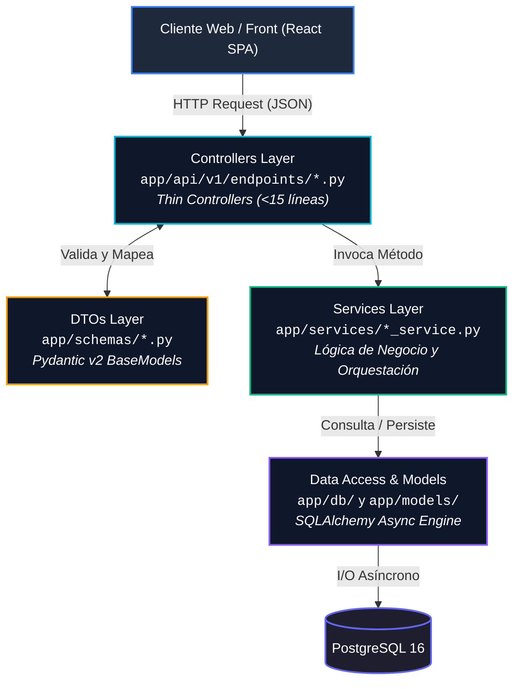

# 🛡️ HoneyMetrics v2 — Backend Universitario

> **Cátedra de Ingeniería de Software — Universidad de Cundinamarca (UDEC Facatativá)**  
> **Integrantes:** Johan Sebastián Posada Beltrán & Juan Pablo Fonseca Celis  
> **Tecnología:** Python 3.12 + FastAPI (Asíncrono)  

---

## 🏛️ Arquitectura de Software: N-Capas Desacoplada

El sistema implementa una arquitectura multicapa empresarial estricta bajo los principios de **Clean Architecture**, asegurando una separación total de responsabilidades y alta testabilidad:



### Tabla de Responsabilidades por Capa

| Capa | Directorio | Patrón de Diseño | Rol y Responsabilidad |
| :--- | :--- | :--- | :--- |
| **Controladores** | `app/api/v1/endpoints/` | **Thin Controller** (<15 líneas) | Recepción de requests HTTP, inyección de dependencias y retorno de status codes (`200`, `201`, `404`). |
| **DTOs** | `app/schemas/` | **Data Transfer Object** | Validación tipada de contratos Request/Response mediante Pydantic v2. |
| **Servicios** | `app/services/` | **Service Layer** | Reglas de negocio puras, lógica de dominio y orquestación de operaciones. |
| **Persistencia** | `app/db/` y `app/models/` | **Repository / Entities** | Sesiones de base de datos asíncronas y modelos declarativos ORM (SQLAlchemy). |
| **Utilidades** | `app/utils/` | **Helper Functions** | Funciones puras transversales (hashing, formateo, utilidades criptográficas). |
| **Semillas** | `scripts/` | **Database Seeding** | Scripts de inicialización y carga de usuarios base (`seed_admin.py`). |

---

## 🌿 Flujo de Trabajo en Git (GitFlow)

El equipo utiliza un modelo de ramas estructurado para Scrum:
- **`main`**: Rama de entregas oficiales y sustentación final.
- **`QA`**: Rama de estabilización previa a cada demo de sprint.
- **`develop`**: Rama de integración continua activa del equipo.
- **`feat/*`**: Ramas de características de trabajo individual por historia de usuario.

---

## 🚀 Inicio Rápido en Desarrollo Local

### Requisitos Previos
- Python 3.12+
- Docker & Docker Compose (para despliegue en contenedores)

### 1. Clonar y Configurar Entorno
```bash
git checkout develop
cp .env.example .env
python3 -m venv .venv
source .venv/bin/activate
pip install -r requirements.txt
```

### 2. Ejecutar Servidor Uvicorn
```bash
uvicorn app.main:app --reload --port 8000
```

### 3. Documentación Interactiva (Swagger / OpenAPI)
- Swagger UI: `http://localhost:8000/docs`
- Redoc: `http://localhost:8000/redoc`
